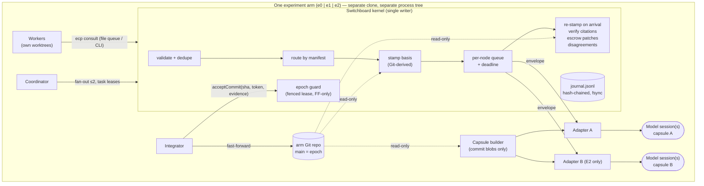
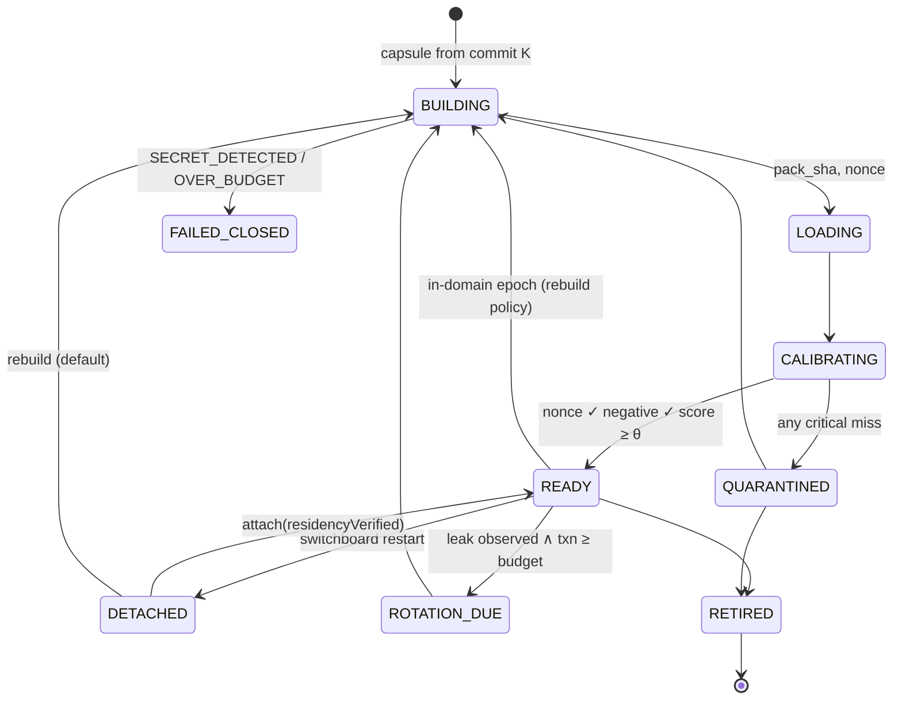
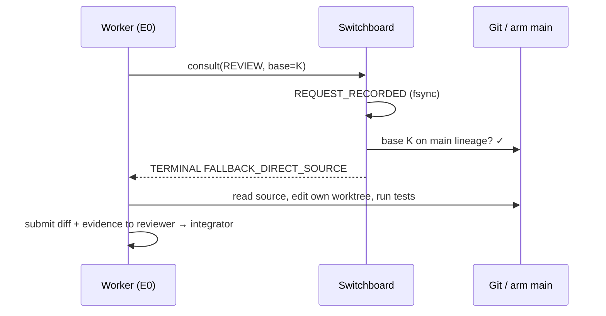
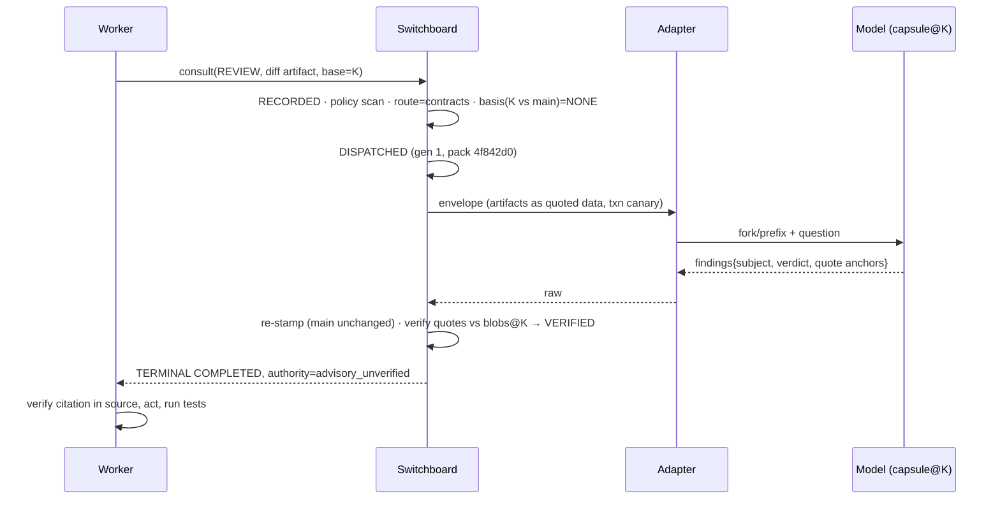
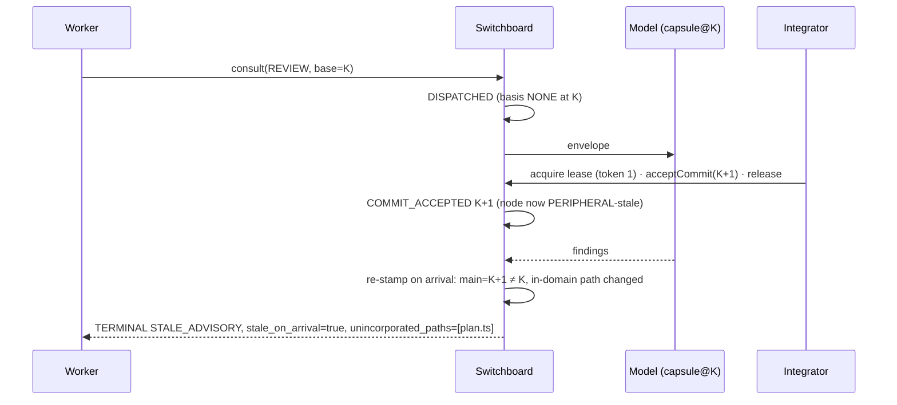
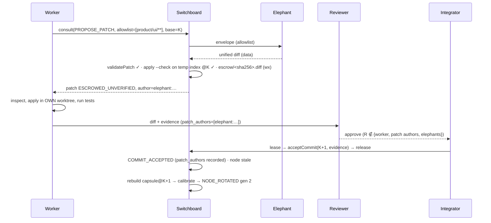

# ARCHITECTURE — Greenfield Ω Elephant protocol, E0 → E1 → E2

**Author role:** claude-architect (first pass, blind to other submissions) · **Edition:** 2026-10-11 · **Protocol:** ECP v0.2
**Claim legend:** `DESIGN` (described only) · `SIMULATED_TEST` (kernel tests with scripted adapters, real Git) · `LIVE_TEST` (none yet) · `MEASURED` (none yet) · `SPECULATION`.

---

## 0. Position in one paragraph

An Elephant is **not a long-lived chat**. It is a *capsule* (a deterministic, commit-built, manifest-scoped context pack with a residency nonce), an *adapter* that can put that capsule in front of a model, and a *ledger* of what that node was shown, when, and how it performed on calibration. The model session is a disposable cache of the capsule, not the source of the Elephant's identity. This single reframing removes the hardest unsolved problem in the v0.1 pack — proving that a "flush" erased hidden turns — by making the default session mode **stateless per request** (fresh fork or cached prefix), so there is nothing to flush. Persistent append-mode sessions remain in the design, but as an *experimental variant* (E1-P) whose extra value must be measured against the stateless default (E1-S), not assumed. Everything else in this document follows from that, plus one rule inherited from the charter and made mechanical: **the wrapper computes every fact about freshness, provenance and citation validity; the model is only asked for claims.**

## 1. Roles and authority

| Role | Identity form | May originate ECP requests | May read product source | May write product source | May advance arm main | Notes |
|---|---|---|---|---|---|---|
| Owner (human) | `owner:<name>` | yes | yes | via normal workflow | yes | Final authority; disposes operator decisions (`BUILD_SEQUENCE.md` §4). |
| Coordinator | `coordinator:<id>` | yes (fan-out on a worker's behalf) | metadata only | **no** | **no** | Scheduling, path-claim leases, gate bookkeeping. Not an Elephant: holds no resident domain context (A4). |
| Worker | `worker:<id>` | **yes** | own worktree | **own worktree only** | no | The only actor that turns advice into code. |
| Elephant node | `elephant:<domain>` | **no** (no capability exists) | its capsule only | **never** | **never** | Advisory output only; may emit a patch *as data* into escrow when the request authorizes it. |
| Independent reviewer | `reviewer:<id>` | yes | yes | separate review worktree if assigned | no | Must differ from the worker and from every patch author; can never be an `elephant:*` id (enforced, test F24). |
| Integrator | `integrator:<id>` | no | yes | integration workspace | **yes**, under fenced lease, fast-forward only | Single writer of arm main. |
| Switchboard (kernel) | process per arm | — | Git objects (read-only) | **never** | records epoch only after integrator acts | Validates, routes, stamps, verifies, journals. |
| Harness adapter | code, not an identity | — | — | — | — | Translates the switchboard's envelope into one harness's CLI/API. |

**Authority is positional, never persuasive.** No output of a model can change a permission, a route, a status, a basis stamp or a verdict about truth. Source, tests and the journal are the only authorities (charter A1).

## 2. Components



| Component | Implemented? | Where |
|---|---|---|
| Journal (append-only, hash chain, fsync, torn-tail recovery, cross-process lock) | `SIMULATED_TEST` | `kernel/journal.mjs` |
| Capsule builder (commit blobs, path policy, secret scan fail-closed, deterministic `pack_sha`, nonce) | `SIMULATED_TEST` | `kernel/capsule.mjs` |
| Basis/staleness calculator (NONE / PERIPHERAL / CONTRACT / DIVERGED) | `SIMULATED_TEST` | `kernel/capsule.mjs` |
| Citation verifier (quote must match blob lines at the node's basis) | `SIMULATED_TEST` | `kernel/capsule.mjs` |
| Switchboard consult pipeline, per-node queue, deadlines, cancel, late results | `SIMULATED_TEST` | `kernel/kernel.mjs` |
| Disagreement records (subject-keyed, never merged) | `SIMULATED_TEST` | `kernel/kernel.mjs` |
| Patch escrow (allowlist, protected paths, temp-index apply check, content-addressed `wx` store) | `SIMULATED_TEST` | `kernel/escrow.mjs`, `kernel/git.mjs` |
| Epoch guard (fenced lease, fast-forward only, reviewer independence) | `SIMULATED_TEST` | `kernel/kernel.mjs` |
| Calibration + residency nonce + transaction-canary isolation probe | `SIMULATED_TEST` (scripted answers) | `kernel/capsule.mjs`, `kernel/kernel.mjs` |
| Worker CLI + file-queue transport | `DESIGN` | `TRADEOFFS.md` §3, `BUILD_SEQUENCE.md` S1 |
| Real harness adapters | `DESIGN` (probe plan only) | `BUILD_SEQUENCE.md` §3 |
| OS-enforced read-only Elephant sandbox | `DESIGN` | `WRITING_AND_TRUTH.md` §6 |
| Notes promotion, ROI router, adaptive partitioning | `DESIGN` / `SPECULATION` | `INVENTION_CANDIDATES.md` |

## 3. Topologies

The topology invariant (charter A4) is **enforced at registration**: `registerNode` throws `TOPOLOGY_VIOLATION` if an arm would exceed 0/1/2 live nodes; quarantined nodes count toward the limit (test F25). A request may never consult more domains than its arm allows.

### E0 — zero Elephants
```
Worker ──consult──▶ Switchboard ──▶ FALLBACK_DIRECT_SOURCE (journaled, no dispatch)
  │
  └─▶ reads source / capsule-free context bundle ─▶ edits own worktree ─▶ tests ─▶ reviewer ─▶ integrator ─▶ arm main
```
E0 workers still go through the switchboard so that *consult intent* is measured identically across arms (how often a worker wanted an advisor is itself a datum). The answer is always the E0 fallback.

### E1 — one Elephant
Domain `command-execution` = `product/core/**` + `product/exec/**`, with `product/ui/**` as `reference`. Contract set: `product/core/contract.ts` plus the event schema. (The kernel fixture uses a smaller `contracts` manifest; the topology rule is the same.)
```
Worker ──consult──▶ Switchboard ──stamp──▶ Adapter ──▶ model(capsule@epoch K) ──▶ claims
                        ▲                                                        │
                        └──── re-stamp on arrival, verify quotes, journal ◀──────┘
```

### E2 — two Elephants, concurrent
`elephant:contracts` = `product/core/**` (command interpretation, ids, schemas, invariants).
`elephant:execution-surface` = `product/exec/**` + `product/ui/**`, with `product/core/contract.ts` as `reference` **and** as a contract path, so a contract change makes *both* nodes CONTRACT-stale (test F10).
Cross-domain consults are a **coordinator fan-out of two independent requests to two nodes in one switchboard call**; there is no Elephant→Elephant channel (ADR-07). Results are two separately stamped claim sets plus zero or more disagreement records.

## 4. Node lifecycle (state machine)

Staleness is deliberately **not** a lifecycle state. It is a relation between a node's `incorporated_sha` and the current epoch, recomputed on every dispatch and every arrival (ADR-02). A node is "READY" if it is correctly based and calibrated; whether it is *current* is answered per request.



Rotation is blue/green: generation *g+1* is built and calibrated **before** the route flips; requests already dispatched to generation *g* finish and are labelled *g* (test F27). There is no `FLUSHING` state: in FORK/PREFIX modes a flush is a no-op by construction, and in APPEND mode a flush **is** a rotation (`FLUSH_RECOVERY.md` §5).

## 5. Request state machine

```
RECORDED ──▶ (policy | base | route | stamp gates) ──▶ DISPATCHED ──▶ per-node outcome ──▶ TERMINAL
   │                       │ fail                                                         ▲
   │                       └──────────────────────────────────────────────────────────────┘
   └── switchboard dies before TERMINAL ──▶ (on restart) TERMINAL{UNKNOWN_TERMINAL}
```

* `REQUEST_RECORDED` is fsync'd **before** anything is dispatched (write-ahead).
* Exactly one `TERMINAL` per idempotency key, ever. Terminal results are immutable; a late remote answer after a terminal is journaled as `LATE_RESULT` for cost accounting only (test F02).
* `UNKNOWN_TERMINAL` is terminal. Retrying the same key returns it without re-dispatch (test F05); a deliberate retry uses a new id/key with `parent_id` pointing at the unknown one.

## 6. Invariants (machine-checked where marked ✔)

| # | Invariant | Enforcement |
|---|---|---|
| I1 | At most 0/1/2 non-retired nodes in e0/e1/e2. | ✔ `registerNode` (F25) |
| I2 | No node is routable unless calibrated (nonce + negative probe + threshold). | ✔ (F26) |
| I3 | Every response carries a basis stamp computed by the switchboard from Git, at dispatch **and** at arrival. | ✔ (F08, F11) |
| I4 | A REVIEW/IMPACT/PROPOSE_PATCH never runs against a CONTRACT-stale or DIVERGED node unless the caller explicitly accepts it. | ✔ (F09, F12) |
| I5 | One TERMINAL per idempotency key; same key + different payload is refused. | ✔ (F03, F04) |
| I6 | Nothing is reported COMPLETED that was not received before the deadline. | ✔ (F02) |
| I7 | Two nodes' answers are never merged; incompatible verdicts on one subject create an OPEN disagreement. | ✔ (F13) |
| I8 | Capsules contain only committed, policy-allowed, secret-free blobs. | ✔ (F18, F19) |
| I9 | The switchboard never writes product source; Elephant code exists only as escrowed data. | ✔ (F21, F22) |
| I10 | Arm main advances only fast-forward, under the current fencing token, with tests passed and reviewer ∉ {worker, patch authors, elephants}. | ✔ (F24) |
| I11 | Exactly one switchboard process writes an arm journal. | ✔ (F31) |
| I12 | Cognition never ingests uncommitted worker code as resident truth; worker drafts arrive only as request artifacts. | ✔ by construction (capsules read commit blobs, F19) |
| I13 | An Elephant cannot originate a request (no hop > 0, no cycles). | ✔ envelope rejects `from: elephant:*` (F23); transport-level authentication of `from` is DESIGN |
| I14 | Read-only is enforced by the OS/tool sandbox, not by prompt text. | DESIGN (`WRITING_AND_TRUTH.md` §6) |

## 7. Architectural decision records

Each decision lists the rejected alternative and the **measurable consequence** that would tell us we were wrong.

| ADR | Decision | Alternative rejected | Measurable consequence / reversal trigger |
|---|---|---|---|
| ADR-01 | **Elephant = capsule + adapter + ledger. Default session mode is stateless per request (FORK if the harness supports a verified fork, else PREFIX = full capsule re-sent with provider prompt caching).** APPEND (one growing session) is the experimental variant E1-P. | v0.1 default: one persistent session per node with selective flush. | If E1-P beats E1-S on verified findings per 1k tokens by > 20% across T5–T7 with no rise in stale claims, promote APPEND for that harness. |
| ADR-02 | Staleness is a computed relation (dispatch + arrival), never a stored node state. | `FRESH→STALE→RECONCILING` lifecycle states. | Count stale-state drift incidents (state says fresh, Git says stale). Expected 0 by construction; any non-zero falsifies. |
| ADR-03 | Capsules are built from **commit blobs** (`git cat-file`), never the working tree. | Pack from filesystem (v0.1 `buildPack`). | Dirty-tree leakage incidents = 0 (F19). Cost: needs Git; no reversal expected. |
| ADR-04 | **Delete the wave layer for v0.2.** On an in-domain epoch, rebuild the capsule (blue/green) instead of appending deltas. | Resident + wave delta appended into the live session. | Rebuild cost per epoch (tokens, wall-ms) vs append cost. Reintroduce waves only if median rebuild > 25% of median consult cost *and* an A/B on T7 shows no rise in old/new-version confusion. |
| ADR-05 | **Flush ≡ rotate** in APPEND mode; no-op in FORK/PREFIX. Never claim a selective flush. Isolation is probed with transaction canaries, and a negative probe is reported as `NOT_PROVEN`, not "isolated". | Selective flush command with claimed erasure. | Leak rate of canaries in APPEND sessions (F28 simulates detection). If a harness offers verifiable context editing, revisit. |
| ADR-06 | Routing is a deterministic manifest lookup (explicit `domains`, else owners of artifact paths). No `HELLO`/`ROUTE` round trip, no LLM router. | Router node computing domain match and confidence. | Mis-route rate measured by post-hoc reviewer labels. Introduce a learned router only if mis-route > 10% of consults. |
| ADR-07 | **No Elephant→Elephant calls (hop limit 0).** Cross-domain = coordinator fan-out ≤ 2, shared deadline. Nodes may emit a `HANDOFF` suggestion as a finding. | One delegated hop, fanout 2 (v0.1 "later"). | Cycles impossible by capability. Reconsider only if fan-out misses > X cross-domain defects that a handoff would have caught, measured on T5. |
| ADR-08 | Model-facing kinds reduced to **ASK, REVIEW, IMPACT, PROPOSE_PATCH**. `REGISTER/STATUS/SYNC/ROTATE/CANCEL/HEALTH` are switchboard verbs, not messages to a model. `FLUSH` deleted (ADR-05). `TRACE`/`EXTRACT` = ASK with trace artifacts / notes output. `DISAGREE` is a switchboard-generated record. | 15 commands, several sent to the model. | Smaller grammar → fewer INVALID_ENVELOPE; track envelope rejection rate. |
| ADR-09 | Findings must carry `subject`, `verdict ∈ {OK, DEFECT, RISK, UNKNOWN}`, `check`, and **quoted** anchors. The switchboard verifies quotes against blobs at the node's basis (VERIFIED / LOCATED / UNANCHORED / INVALID). | Free-text findings with path/line only. | Citation-invalid rate per node; unverified findings are excluded from "verified evidence" counts in scorecards. |
| ADR-10 | One hash-chained, fsync'd JSONL journal per arm, single writer (lock), write-ahead before dispatch, `UNKNOWN_TERMINAL` on recovery. State = fold(journal). | In-memory map (v0.1 mock) or a database. | Recovery drills: 0 false COMPLETED, 0 double terminals (F05–F07, F31). |
| ADR-11 | Epoch guard: fenced lease token, fast-forward only, reviewer independence and Elephant-exclusion checked at acceptance. | Trust the integrator's process. | Unauthorized/untraceable merges = 0 (F24). |
| ADR-12 | Patch escrow: immutable content-addressed diff, allowlist + protected paths, `git apply --check` on a temp index at the worker's base; status is `ESCROWED_UNVERIFIED` until a worker applies and a reviewer accepts. | Elephant writes in a disposable worktree (regime R). | Survival rate of Elephant patches; rework minutes per accepted Elephant patch vs worker-only (H4). |
| ADR-13 | Transport v0.2 = in-process library behind a **file-queue CLI** (`ecp/inbox` → `ecp/outbox`). ACP/MCP live *inside adapters* only. | Local HTTP service, MCP server facade, or ACP as ECP. | Operator minutes for setup; if > 1 h per arm or file-queue latency > 1 s p95, move to a named-pipe service. |
| ADR-14 | Per-node serialized queue (1 in flight, cap `q`), absolute deadline that includes queue wait, `OVER_CAPACITY` instead of waiting. | Unbounded queue, per-hop deadlines. | Queue-wait share of Elephant latency; raise concurrency only after a harness proves isolated concurrent sessions. |
| ADR-15 | CONTRACT staleness fails closed for sensitive kinds; PERIPHERAL staleness proceeds stamped. | Uniform stale handling. | Stale-induced false findings on T7 split by class; if PERIPHERAL stale findings cause > 1 accepted defect, tighten. |
| ADR-16 | `epoch_policy: same` → `MIXED_EPOCH` refusal; synchronizing nodes is an explicit coordinator act, never implicit. | Auto-sync before dispatch. | Count of high-risk cross-domain reviews answered on mixed epochs (target 0). |
| ADR-17 | Residency **nonce canary** in every capsule: calibration must repeat it; a resumed session must repeat it *without* re-injection to count as a reused session. | Trusting a harness "session id". | Distinguishes real resume from re-prompting (answers the ZCode brief's "prove reuse" question). |
| ADR-18 | Topology is enforced at registration and labelled per answer (`topology_planned` vs `topology_effective`, `degraded`). | Arm-level labels only. | Every degraded answer is attributable; scorecards can exclude or separate them. |

## 8. Atomic vs eventually consistent

| Must be atomic (single fsync'd journal append; no partial visibility) | May be eventually consistent |
|---|---|
| `REQUEST_RECORDED` (idempotency registration + fingerprint) | Node capsule rebuild after an epoch advance |
| `TERMINAL` (one per key, immutable) | Calibration scoring and quarantine of a rebuilt generation |
| `COMMIT_ACCEPTED` (epoch advance, fencing token, evidence ids) | Notes promotion / rejection |
| `LEASE_GRANTED` / `LEASE_RELEASED` | Metrics, scorecards, ROI ledger |
| `NODE_REGISTERED` / `NODE_ROTATED` (route flip) | Isolation probes |
| Escrow write (`wx`, content-addressed) | Disagreement resolution (by later test evidence) |

A two-node E2 answer is **not** an atomic collective snapshot: it is a set of separately stamped claims (`responses[*].basis`). `mixed_epoch` makes the difference visible; `epoch_policy: same` makes it refusable.

## 9. Message flows (sequence diagrams + simulated traces)

Each flow below has a deterministic trace in `traces/` generated by `node kernel/demo.mjs` (claim level `SIMULATED_TEST`: real Git and journal, scripted model).

### 9.1 E0 normal — `traces/01-e0-normal.trace.txt`


### 9.2 E1 review — `traces/02-e1-review.trace.txt`


### 9.3 E2 conflicting reviews — `traces/03-e2-conflicting-reviews.trace.txt`
```mermaid
sequenceDiagram
  participant W as Worker
  participant S as Switchboard
  participant EA as elephant:contracts
  participant EB as elephant:execution-surface
  W->>S: consult(REVIEW, domains=[contracts, execution-surface])
  S->>S: RECORDED · both bases NONE · DISPATCHED(A,B)
  par shared deadline
    S->>EA: envelope
    EA-->>S: C-TARGET-STATUS: OK
  and
    S->>EB: envelope
    EB-->>S: C-TARGET-STATUS: DEFECT
  end
  S->>S: subject match, verdicts incompatible → disagreement d-… OPEN
  S-->>W: TERMINAL COMPLETED + disagreements[1] (no consensus field)
  W->>W: run proposed falsifiers; record RESOLVED_BY_TEST with test evidence
```

### 9.4 E2 node crash — `traces/04-e2-node-crash.trace.txt`
```mermaid
sequenceDiagram
  participant W as Worker
  participant S as Switchboard
  participant EA as elephant:contracts
  participant EB as elephant:execution-surface
  W->>S: consult(domains=[A,B])
  S->>EA: envelope
  S->>EB: envelope
  EA-->>S: findings
  EB--xS: session lost (MODEL_ERROR)
  S-->>W: TERMINAL PARTIAL, topology_effective=e1, degraded=true
  Note over S: B contributes no findings. Operator sees B unusable; rotate B (FLUSH_RECOVERY §8.2).
```

### 9.5 Epoch change while a request is in flight — `traces/05-epoch-change-in-flight.trace.txt`


### 9.6 Patch proposal accepted — `traces/06-patch-proposal-accepted.trace.txt`


## 10. Where design stops and implementation begins

* **Implemented (`SIMULATED_TEST`)**: everything in `kernel/` — 32 tests, 6 traces.
* **Implemented in this pack but not by me**: `tools/ecp` v0.1 mock (13 tests). v0.2 does not depend on it; it may be retired once a judge accepts v0.2.
* **Design only**: worker CLI + file queue, real adapters, OS sandbox, notes promotion, ROI router, Windows path case-folding guard (fault F35), Tauri product.
* **No live claims**: no model session has been opened, nothing has been measured, no speedup is asserted.
